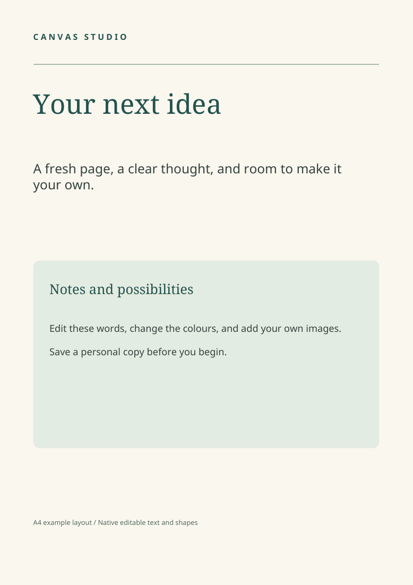

# Canvas Studio

A standalone desktop editor for visual designs and printable documents, written
in Rust with egui. Design and editing run locally, without an account,
subscription or connected model service.

Current development: **1.21.0**, with shared task-led Home screens, personal
Reference Desk research imports, imported fonts, rich paragraphs, portable
projects, linked collections/CSV production, books, checked word searches and
local browser editing. A 42-template / 95-page visual catalog includes editable
Instagram carousels/stories and YouTube thumbnails/channel artwork. Launchers
use the publishing profile: design, campaigns, video editing and Research;
image/video generation is an optional later capability.
See [changes](CHANGELOG.md), the [print-first roadmap](docs/ROADMAP.md) and
the [practical workflow guide](docs/PRINT-STUDIO-GUIDE.md).
The [whole-app usability review](docs/USABILITY-REVIEW-2026-11-27.md) prioritises
guided workflows, browser/desktop consistency and the requirements for public hosting.



See the [starting workflows](docs/STARTING-WORKFLOWS.md),
[personal Research guide](docs/PERSONAL-RESEARCH.md) and
[hosting options](docs/HOSTING-OPTIONS.md).

## Browser editing

Run `./run-browser.sh` or `./canvas-studio --serve-browser` and open the private
local URL printed in the terminal. Add `--open /path/to/design.canvas` to start
with a portable project. Personalise fields, edit text/photos/layout and download
native editable files or print outputs. No paid service or Node runtime is needed.

This is a local browser editor backed by the desktop engine; it is not a hosted
multi-user customer service. See the [browser guide](docs/BROWSER-EDITOR.md) for
supported controls, recovery, delivery formats and limits.

## Linked campaigns

A [campaign](docs/CAMPAIGN-STUDIO.md) keeps separately composed print, Instagram
and YouTube layouts in one portable project. Shared copy/brand colours and reusable
groups stay linked. Browser layout tools support multi-selection, grouping,
proportional resizing, alignment/distribution and keyboard nudges. Download all
formats as a campaign bundle with the editable master and output manifest.

## Optional personal generation tools

The publishing profile hides generation and rejects generation requests.
`CANVAS_STUDIO_PROFILE=personal ./run.sh` explicitly opens the existing optional
personal tools. This is not a hosted paid-generation integration; provider and
model terms still apply.

[Generation studio](docs/GENERATION-STUDIO.md) adds reviewed free-weight image/video
recipes, live Hugging Face/Civitai metadata discovery, a model/content-mode selector,
uploaded first-frame images and page snapshots, compatible adapters and optional NF4/offload controls.
Prepare private finite Kaggle notebooks offline, or submit with your configured
account and import completed PNG/MP4 assets into Design/Video studio. A separate
[standalone Kaggle MCP](docs/KAGGLE-MCP.md) shares this backend. Credentials and model
weights stay outside projects/Git. Free weights do not imply unlimited free GPU
quota or universal commercial rights. Real Tesla T4 image/video generation, download,
import and playback passed the scoped [GPU acceptance checks](docs/KAGGLE-GPU-ACCEPTANCE.md).
Other recipes need individual validation; CPU integration uses tiny random test weights.

The expanded library includes creator media kits, UGC rate cards, lookbooks,
reel covers, case studies, shot lists/storyboards, content planners, educational
worksheets, service menus, event newspapers, book/recipe pages and lead magnets.
Each is an editable starting system with sample copy to replace before publishing.

## Film, sound and captions

[Film studio](docs/FILM-STUDIO.md) adds local media import, frame-based tracks,
trim/split, proxies, audio gain/fades, manual captions/SRT and editable design
overlays. Render synchronized previews and H.264/AAC MP4s as cancellable snapshot
jobs. Originals travel in portable projects. Browser playback is integrated;
native playback opens in ffplay. Python 3 and FFmpeg/FFprobe are required for
media work. Saved keyframes and a deterministic HyperFrames adapter are available in
[Motion studio](docs/MOTION-STUDIO.md), with source ZIP/manifest delivery and
optional pinned Node/Chromium setup. [Product studio](docs/PRODUCT-MOCKUPS.md) adds
Three.js books, boxes and stationery with listing PNGs and six-second reveals.

## Design with a coding agent

The local [STDIO MCP adapter](docs/AGENT-CONTROL.md) exposes 15 tools to inspect,
compose, preview, check and export the live browser design. It uses explicit
document/revision checks, atomic undoable batches and a scoped local workspace.
No model subscription or Python package is required by the adapter itself.

See the [professional studio review and next milestones](docs/PROFESSIONAL-STUDIO-REVIEW-2026-11-02.md)
for the motion/HyperFrames/Three.js direction and current limitations.

## Run the app

Download the Linux x86-64 archive from
[Releases](https://github.com/krytenk/canvas-studio/releases), extract it, and run:

```bash
./canvas-studio
```

The executable embeds its fonts and can be launched from any directory. The
release archive also includes the font licence, launcher and an example layout.
Use a Linux desktop with X11 or Wayland and working graphics drivers. The initial
binary is built on Ubuntu 24.04; it requires compatible system libraries and is
not a fully static executable. Native Windows and macOS binaries are not provided
in this release.

## Build from source

Install a current stable Rust toolchain. On Ubuntu/Debian, install the native
development libraries:

```bash
sudo apt-get update
sudo apt-get install build-essential pkg-config libx11-dev libxi-dev \
  libxcursor-dev libxrandr-dev libxkbcommon-dev libwayland-dev libegl1-mesa-dev
cargo build --release --locked
./target/release/canvas-studio
```

Alternatively, `./run.sh` starts an existing build or builds the application.
Fonts are included in this repository; no separate font installation is needed.

## What it does

- Multiple pages, editable text, shapes, drawings, photographs and layer controls.
- A4, US Letter, 5-by-7-inch and screen-format presets, plus custom physical sizes.
- Built-in example templates and procedural sample images.
- Local image adjustments, crop/fit controls and resizing tools.
- Undo/redo, checked saves, unsaved-change prompts and per-document recovery.
- PNG, SVG, PDF and HTML presentation export.
- Font and export preflight checks that report unsupported content.
- Generic layout JSON import, including image paths relative to the layout file.
- Personal production masters with preview thumbnails, tags and search.
- Text size in points, line height, tracking and overflow warnings.
- Numeric position/size in mm, inches or layout pixels, plus aspect lock and flips.

The creative writing and image tools are local algorithms. They do not connect to
a hosted generative-AI service.

## Save and share designs

Save an editable project as `design.canvas.json`. Images are written into a
companion `assets/` directory beside that JSON. **Move or share both together.**
The app also accepts compatible older JSON projects, including their older font
identifiers. Opening an older file does not automatically overwrite it.

## Reuse a personal template

In **Design Templates**, enter a name and optional comma-separated tags under
**My Templates**, then choose **Save Current Design as New Master**. Production
masters must pass export preflight. Ordinary project saves remain available for
designs using unsupported preview effects.

Use **Open New Copy** to start a separate working document. The master retains
its files and identity. Save the working document to your chosen location.
The library is stored in the system application-data directory under
`canvas-studio/templates`; each entry contains its metadata, preview, project
and companion assets. Copy that complete folder when backing up or moving the
library. It runs locally and does not create customer browser-editing links.

Select a text element and open **Typography** for point size, leading and
tracking. Open **Layers & Position** for numeric geometry, units and aspect lock.

Recovery is stored per document in the system application-data directory:

- Linux: `$XDG_DATA_HOME/canvas-studio/recovery`, or
  `~/.local/share/canvas-studio/recovery`.
- macOS source builds: `~/Library/Application Support/canvas-studio/recovery`.
- Windows source builds: `%LOCALAPPDATA%\canvas-studio\recovery`.

## Import a layout

Choose **Design → Import Layout JSON** and select
[`examples/layout.json`](examples/layout.json). The schema accepts a collection,
a single page, or an array of collections (the interactive import opens the first
collection). Coordinates use 96 logical units per inch. An image operation's
`path` can be absolute or relative to the JSON file's directory.

To export the example without opening a window:

```bash
./canvas-studio --export-layout examples/layout.json sample.pdf
./canvas-studio --self-check
./canvas-studio --version
./canvas-studio --verify-project path/to/design.canvas.json
```

## Current limits

This is a local desktop editor. It does not offer collaborative browser editing,
cloud template-copy links, PPTX import/export or hosted video generation.

Some decorative effects, brushes, shaped photo borders and charts cannot yet be
faithfully printed and are blocked by export preflight. Templates that use such
features need those elements simplified before print export. Ordinary supported
text, shapes, tables, gradients and photos use the shared rendering pipeline.
Complex-script typography, physical printer behaviour and commercial PDF/X or
PDF/A compliance are not certified. Proof a page before printing a batch.

## Development checks

PDF regression checks use Poppler (`pdftotext` and `pdftoppm`). On Ubuntu:

```bash
sudo apt-get install poppler-utils
cargo fmt --all -- --check
cargo test --release --locked
```

The GitHub workflow runs these checks and builds the Linux application. See
[`docs/VALIDATION.md`](docs/VALIDATION.md) for the release verification record.

## Third-party components

Bundled fonts retain the SIL Open Font License. See
[`THIRD_PARTY_NOTICES.md`](THIRD_PARTY_NOTICES.md). A project-wide reuse licence
has not yet been selected; making this repository public does not change the
licences of its dependencies.

### Imported fonts

Use **Typography → Import TrueType Font** to add a static `.ttf` face. Select it
in the font menu; import separate bold/italic faces when needed. Font bytes travel
inside the saved project and template, so the source font file is not needed later.
Only faces permitting editable outline embedding are accepted. Variable fonts,
collections and CFF outlines are not supported yet.

### Paragraphs and emphasis

Select a text frame and open **Typography** to set paragraph spacing, indentation
and frame insets. Double-click the canvas text and select characters, then apply
emphasis or an actual font face in the Typography panel. The main toolbar controls
the frame defaults. **Clear character styles** removes range overrides.

### Portable projects and print settings

Use **Export → Save Editable Portable Copy** to create a single `.canvas` file
containing the design, images and imported fonts. Open it through the project
file chooser. JSON plus companion assets remains supported. Portable packages
have a 512 MB unpacked limit and verify their contained images when loading.

Open **Design Templates → Print guides & safe area** for safe margins and custom
guides in millimetres. Guide overlays do not appear in exports. Named output
presets in Export remember DPI, bleed, crop marks and transparency with the design.

### Collections and CSV production

Open **Production** to define field keys and values. Use `{{guest_name}}` within
text, or bind a selected text/photo frame. Required values are checked before
delivery. Choose a photo once to update every frame bound to that field.

Save a shared style from selected text, then link other frames to that key.
Replacing the shared style updates linked frames in preview and output; the
frame retains its own editable source and character emphasis.

CSV headers must exactly match defined field keys. Quoted commas, multiline
values and Unicode are supported; photo values refer to local files relative
to the CSV or absolute paths. Batch production runs in the background and writes
a new folder with PDF/proof files and `report.json`. Missing required values,
unsupported content and text overflow fail the affected record. No master is
overwritten. Enable editable copies if native `.canvas` files are also needed.

### Product mockups and Linux desktop shortcut

Version 1.15 adds [Three.js product studio](docs/PRODUCT-MOCKUPS.md): editable
cover artwork on books, boxes and stationery, listing PNGs, six-second video
reveals and portable scene/source delivery. Browser **Mockups** offers live 3D;
native **Tools** and **Book** offer art direction and rendered poster review.

Run `python3 scripts/install_desktop.py` from the app folder to create or repair
your Linux desktop/menu shortcuts. Existing Camva launchers are backed up and
redirected to the current app. The launcher works independently of the current
directory, accepts a `.canvas` file, and writes private startup details to
`~/.local/state/canvas-studio/desktop.log` (or `$XDG_STATE_HOME/canvas-studio`).
