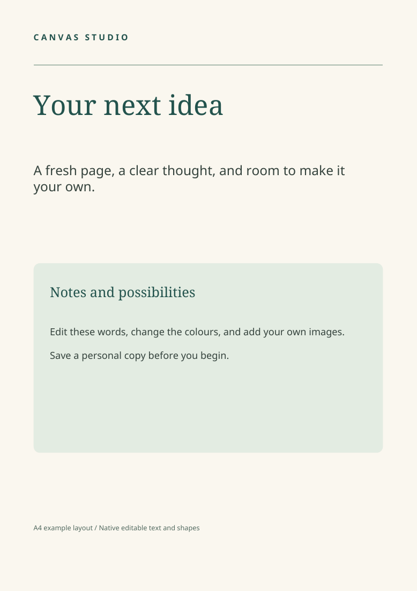

# Canvas Studio

A standalone desktop editor for visual designs and printable documents, written
in Rust with egui. Design and editing run locally, without an account,
subscription or connected model service.

Current development: **1.4.0**, with corrected template exports, group editing,
a personal template library and print typography/position controls.
See [changes](CHANGELOG.md) and the [print-first roadmap](docs/ROADMAP.md).



## Run the app

Download the Linux x86-64 archive from
[Releases](https://github.com/krytenk/canvas-studio/releases), extract it, and run:

```bash
./canvas-studio
```

The executable embeds its fonts and can be launched from any directory. The
release archive also includes the font licence, launcher and an example layout.
Use a Linux desktop with X11 or Wayland and working graphics drivers. The initial
binary is built on Ubuntu 24.04; it requires compatible system libraries and is
not a fully static executable. Native Windows and macOS binaries are not provided
in this release.

## Build from source

Install a current stable Rust toolchain. On Ubuntu/Debian, install the native
development libraries:

```bash
sudo apt-get update
sudo apt-get install build-essential pkg-config libx11-dev libxi-dev \
  libxcursor-dev libxrandr-dev libxkbcommon-dev libwayland-dev libegl1-mesa-dev
cargo build --release --locked
./target/release/canvas-studio
```

Alternatively, `./run.sh` starts an existing build or builds the application.
Fonts are included in this repository; no separate font installation is needed.

## What it does

- Multiple pages, editable text, shapes, drawings, photographs and layer controls.
- A4, US Letter, 5-by-7-inch and screen-format presets, plus custom physical sizes.
- Built-in example templates and procedural sample images.
- Local image adjustments, crop/fit controls and resizing tools.
- Undo/redo, checked saves, unsaved-change prompts and per-document recovery.
- PNG, SVG, PDF and HTML presentation export.
- Font and export preflight checks that report unsupported content.
- Generic layout JSON import, including image paths relative to the layout file.
- Personal production masters with preview thumbnails, tags and search.
- Text size in points, line height, tracking and overflow warnings.
- Numeric position/size in mm, inches or layout pixels, plus aspect lock and flips.

The creative writing and image tools are local algorithms. They do not connect to
a hosted generative-AI service.

## Save and share designs

Save an editable project as `design.canvas.json`. Images are written into a
companion `assets/` directory beside that JSON. **Move or share both together.**
The app also accepts compatible older JSON projects, including their older font
identifiers. Opening an older file does not automatically overwrite it.

## Reuse a personal template

In **Design Templates**, enter a name and optional comma-separated tags under
**My Templates**, then choose **Save Current Design as New Master**. Production
masters must pass export preflight. Ordinary project saves remain available for
designs using unsupported preview effects.

Use **Open New Copy** to start a separate working document. The master retains
its files and identity. Save the working document to your chosen location.
The library is stored in the system application-data directory under
`canvas-studio/templates`; each entry contains its metadata, preview, project
and companion assets. Copy that complete folder when backing up or moving the
library. It runs locally and does not create customer browser-editing links.

Select a text element and open **Typography** for point size, leading and
tracking. Open **Layers & Position** for numeric geometry, units and aspect lock.

Recovery is stored per document in the system application-data directory:

- Linux: `$XDG_DATA_HOME/canvas-studio/recovery`, or
  `~/.local/share/canvas-studio/recovery`.
- macOS source builds: `~/Library/Application Support/canvas-studio/recovery`.
- Windows source builds: `%LOCALAPPDATA%\canvas-studio\recovery`.

## Import a layout

Choose **Design → Import Layout JSON** and select
[`examples/layout.json`](examples/layout.json). The schema accepts a collection,
a single page, or an array of collections (the interactive import opens the first
collection). Coordinates use 96 logical units per inch. An image operation's
`path` can be absolute or relative to the JSON file's directory.

To export the example without opening a window:

```bash
./canvas-studio --export-layout examples/layout.json sample.pdf
./canvas-studio --self-check
./canvas-studio --version
./canvas-studio --verify-project path/to/design.canvas.json
```

## Current limits

This is a local desktop editor. It does not offer collaborative browser editing,
cloud template-copy links, PPTX import/export or hosted video generation.

Some decorative effects, brushes, shaped photo borders and charts cannot yet be
faithfully printed and are blocked by export preflight. Templates that use such
features need those elements simplified before print export. Ordinary supported
text, shapes, tables, gradients and photos use the shared rendering pipeline.
Complex-script typography, physical printer behaviour and commercial PDF/X or
PDF/A compliance are not certified. Proof a page before printing a batch.

## Development checks

PDF regression checks use Poppler (`pdftotext` and `pdftoppm`). On Ubuntu:

```bash
sudo apt-get install poppler-utils
cargo fmt --all -- --check
cargo test --release --locked
```

The GitHub workflow runs these checks and builds the Linux application. See
[`docs/VALIDATION.md`](docs/VALIDATION.md) for the release verification record.

## Third-party components

Bundled fonts retain the SIL Open Font License. See
[`THIRD_PARTY_NOTICES.md`](THIRD_PARTY_NOTICES.md). A project-wide reuse licence
has not yet been selected; making this repository public does not change the
licences of its dependencies.

### Imported fonts

Use **Typography → Import TrueType Font** to add a static `.ttf` face. Select it
in the font menu; import separate bold/italic faces when needed. Font bytes travel
inside the saved project and template, so the source font file is not needed later.
Only faces permitting editable outline embedding are accepted. Variable fonts,
collections and CFF outlines are not supported yet.

### Paragraphs and emphasis

Select a text frame and open **Typography** to set paragraph spacing, indentation
and frame insets. Double-click the canvas text and select characters, then apply
emphasis or an actual font face in the Typography panel. The main toolbar controls
the frame defaults. **Clear character styles** removes range overrides.
