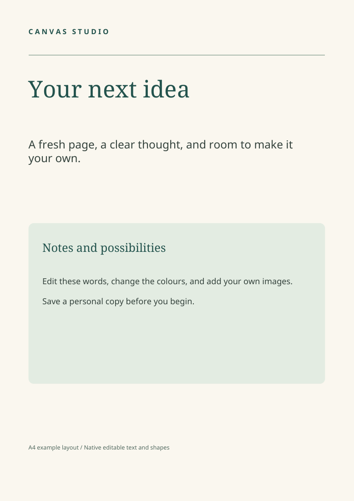

# Canvas Studio validation

## 1.13.0 film foundation

84 local Rust checks pass, including frame edits, source/envelope preservation,
SRT Unicode/timing, identity/overflow rejection, native film undo/redo and detaching dialogue while
a music track is already occupied.
The real STDIO media workflow passes decoded clip boundaries, a 48 kHz audio
impulse (about 0.08 ms timing error in the tested fixture), exact eight-second
video/audio metadata, identical audio across splits within fades, captions/frame
review, proxies, cancelled partial-output cleanup, wrong-document/workspace/no-
overwrite guards and a cold-cache portable restore. A deliberately damaged
original fails verification and is repaired by reopening the portable project.

A moving 24 fps source split on frame 37 of a 30 fps timeline retains an identical
decoded frame sequence; resetting the FPS sampling phase at the split originally
failed this check and was corrected with a persisted source anchor/frame offset.
The existing MCP and campaign CLI workflows also pass. GitHub CI repeats browser
and native workflows, plus the new isolated Film interface workflow. The 30-
second licensed demonstration is built through MCP by `make_film_demo.py`.

See [Film studio](FILM-STUDIO.md) for dependencies, limits and native/browser
playback differences. These are targeted acceptance checks, not proof of every
codec, every host platform, zero-latency native AV editing, or a full NLE suite.

## 1.12.0 campaign/layout integration

79 local Rust checks pass. New coverage exercises four independent layouts,
shared copy/brand colours, exact rendered round trips, assets living only in
inactive layouts/components, group-aware operations, lock rejection and linked
typography materialized for component/selection scaling. The real STDIO campaign
workflow passes named-layout previews/exports without changing the live document,
selectable shared text in all PDFs, portable cold loading and ZIP CRC/manifest/
pixel-dimension checks. The browser/native campaign acceptance is also a required
CI workflow; see `scripts/campaign_smoke.py` and the campaign guide.

## 1.11.0 studio and agent integration

75 release checks pass, including the 18-design / 27-page catalog, all-template
production/export proofs, atomic batch rollback/dry-run/undo, alias resolution,
custom dimensions and guarded image previews. The native/browser UI workflows
remain required CI checks. New browser coverage exercises visual catalog search,
carousel preview/insertion, live agent refresh with draft preservation and vector
shape editing; the 700 px overflow check remains in place.

`scripts/mcp_smoke.py` drives the real STDIO adapter and native browser engine.
Both current per-request and legacy initialization protocols pass; a fresh
adapter process uses explicit document handles. The workflow composes a campaign,
checks it, previews its image, exports exact 1080×1350 PNG and selectable-text PDF,
then opens a portable project with fonts/photos in a cold native process.
Rollback, dry-run, undo/redo, stale revisions, wrong documents, scoped paths,
outside symlinks, no-overwrite and credentials excluded from tool results pass.
Proofs are under ignored `qa/mcp/`. No particular coding-client installation,
video render, 3D workflow or public hosting is certified by these tests.

## 1.9.0 browser/native integration

73 release checks pass. New coverage includes browser edit/undo/revision semantics,
portable font/image delivery, recovery failure preservation, JPEG replacement,
required-field and modified-puzzle rejection, invalid documents, HTTP parsing,
host/origin/token checks and rejecting unauthorized uploads before their bodies.

Isolated Chrome and bundled Chromium workflows personalise all five pages of a
collection, replace a linked JPEG photo, add text, change paragraph/character
styling, import a font, rename a page, undo/redo, download PDF/editable files, reopen
the delivered project and insert another photo. PDF text extraction verifies the
shared name on all five pages and Unicode text; the native executable opens the
delivered and recovery projects. Restarting the server on the same port restores
the document with a new session token. The 700 px layout has no horizontal overflow,
and no page-script errors were reported. Unapplied forms survive in-app refresh
and block stale downloads. Screenshots are visually reviewed locally.

The repeatable native-window driver passes at 1024×680 on isolated Xvfb: title
editing/save/reopen, undo/redo, tool scrolling, Book/Next and the export dialog.
GitHub CI now repeats both UI workflows and uploads their proofs. Physical printing,
all desktop/browser platforms, public multi-user hosting and full-resolution book
stress acceptance are not established by these checks.

## 1.8.1 native desktop validation

Launched the real egui desktop executable on the Wayland desktop through X11.
Visual inspection at 1408×680 exposed inaccessible rail tools and initial page
cropping. Wayland blocked synthetic input, so repeatable native-window interactions
ran on an isolated Xvfb X11 display with separate application data and a copied
project. No existing user projects were changed.

Native interactions verified 1024×680 layout, resizing with Fit retained, title
editing, quick Ctrl+S, save/reopen, undo/redo, scrolling to Book/Puzzles, book page
selection and the export/preflight dialog. Screenshots and the copied project are
kept locally under `qa/desktop/`; `scripts/native_ui.py` records the X11 driver.
A rapid modifier-release save failure was reproduced and fixed.

66 release tests pass, including same-frame modifier release, bounded 100-page
navigation, initial/resized fit, group identities and book header/folio safe areas.
The release build passes. This does not certify every native dialog, every desktop
backend, a real printer, or a full-resolution artwork stress workload.

## 1.8.0 local validation

63 release checks pass, including 180 seed/difficulty combinations, deterministic
regeneration, invalid/duplicate vocabulary, accidental repeated target words,
minimum/maximum grid sizes, changed generated-layer detection and portable
recipe editing in a fresh process. Template insertion retains remapped recipes.

A 50-puzzle/50-answer-page book saves/reopens and exports as a 100-page PDF.
The sample puzzle and answer PDFs were independently rendered with Poppler and
visually reviewed. A separate Python solver verified exactly one occurrence of
every sample target and matched all saved solution coordinates. Styling rebuilds
preserve grid/placements and added custom artwork; invalid rebuilds preserve the
source. Vocabulary/filler suitability and physical printing still need human review.

## 1.7.0 local validation

57 release checks pass. A synthetic 50-page workbook with 512×640 artwork was
imported, reordered/undone, numbered, saved/reopened as a portable project and
exported as a full PDF and a page-range PDF. Poppler confirmed page count/text;
the first two independently rendered pages were visually reviewed. Blank backs,
front matter, master edit/cancel, image-only master persistence in a fresh process,
damaged master assets and concurrent-import preservation are covered.

The isolated workbook check took 2.00 seconds and peaked at 159,236 KiB RSS
on this machine (50 synthetic 512×640 images, 96-DPI PDF settings).
Pixel-copy tests verify shared storage and independent edits. The low-resolution
fixture is a layout/production check, not a full-resolution commercial-book stress
test. Native desktop operation and physical printing remain open.

## 1.6.0 local validation

51 release checks include collection-wide field/style updates with master preservation,
portable photo fields, unfilled template masters, CSV quoting/Unicode, and a
52-record job with 50 successful PDFs/proofs plus two reported invalid records.
Collection PDF text extraction confirms the updated names/date on all five pages.

## 1.5.0 local validation

47 release checks cover the previous workflows plus a moved single-file project
opened in a fresh process with image assets, imported font bytes, paragraph insets,
guides and an output preset. PDF text extraction verified the reopened result.
Failed portable saves preserve the destination; damaged/path-traversing packages
are rejected. Guides leave raster exports unchanged, and unsafe text is identified
by preflight. Native desktop and physical-print acceptance remain open.

## 1.4.0 local validation

43 release tests passed, including styled Unicode wrapping, uppercase expansion,
character-range adjustment after editing and rich-paragraph save/reopen/export.
The paragraph PDF was independently rendered with Poppler and visually inspected;
its raster ink bounds matched the native raster proof within six pixels at 150 DPI.
The existing legacy document and export checks continue to pass.

## 1.3.0 local validation

41 release tests, formatting and the release build passed on 1 November 2026.
New font checks cover loading embedded TrueType bytes in a fresh process, Unicode
PDF text extraction, `pdffonts` verification, SVG font embedding, template insertion,
missing/corrupt-font rejection and documents without the new font field.

## 1.2.0 local validation

Verified on 1 November 2026 on Linux x86-64 / Ubuntu 24.04:

| Check | Result |
| --- | --- |
| Formatting | Passed |
| Release tests, offline and locked | 38 passed; 0 failed |
| Release build | Passed |
| Seven built-in templates, eight pages total | Edited title, saved/reopened, preflight at 300 DPI, PDF/PNG/SVG/HTML export at proof settings |
| Independent PDF verification | Poppler text extraction and renders succeeded; eight rendered pages visually reviewed |
| Group operations | Fresh copy identities, proportional scaling, rotation, protected original, undo/redo and save/reopen checked |
| Different-size template insertion | All pages inserted proportionally, unique identities, source preserved and undo checked |
| SVG/HTML unsupported effects | Explicit errors; no silent effect omission through the checked export APIs |
| Personal masters | Image assets and previews saved; independent copy identities and master preservation checked |
| Moved template library | Opened and rendered successfully in a fresh child process |
| Invalid metadata / failed template saves | Healthy entries retained, errors reported and no partial entries left behind |
| Inspector geometry | Inch/mm conversion and aspect ratio checked; non-finite edits rejected without partial changes |
| Typography, layers and template panels | Headless frames rendered without dirtying or mutating the document |

Template proof PDFs use 96-DPI raster fallback settings to keep regression checks
small, while preflight runs at 300 DPI. These are layout proofs, not a claim that
each low-resolution sample image is suitable for commercial print. The suite also
retains physical-size, font, Unicode, image and independent-render checks from the
previous release.

Manual native desktop interaction and physical printer acceptance are still open.
The new font controls use the bundled families; imported-font and rich-text support
are not part of 1.2.0. GitHub workflow status is reported separately from these
local results.

## 1.1.0 original release validation

Verified on 1 November 2026 with Rust 1.99.1 on Linux x86-64 / Ubuntu 24.04.

| Check | Result |
| --- | --- |
| `cargo fmt --all -- --check` | Passed |
| `cargo test --release --offline --locked` | 28 passed; 0 failed |
| `cargo build --release --offline --locked` | Passed |
| Launcher shell syntax | Passed |
| Executable copied into an unrelated temporary directory | Version and self-check passed |
| All ten embedded font faces | Loaded without an external font directory |
| CLI example layout to PDF | One A4 page; text extracted independently with Poppler |
| Independent render of the example PDF | Visually checked; no clipped or overlapping content |
| Moved layout with relative image paths | Imported, saved and reopened successfully |
| Deleted referenced image | Correctly rejected |
| Release source and executable content review | No private catalogues, workstation paths or account credentials included in the source; no private product identifiers found in the executable |

The test suite also covers failed-save safety, cold-process image loading,
per-document recovery, undo branches, same-frame editing/save behaviour,
fractional physical sizes, export allocation limits, Unicode PDF text,
rotation, tables, gradients and photo adjustments.

The native file dialogs, graphics-driver/window-manager behaviour and physical
printers were not manually operated for this release. Windows and macOS binary
builds were not tested. Unsupported print features remain subject to export
preflight; see the README for the current feature limits.

